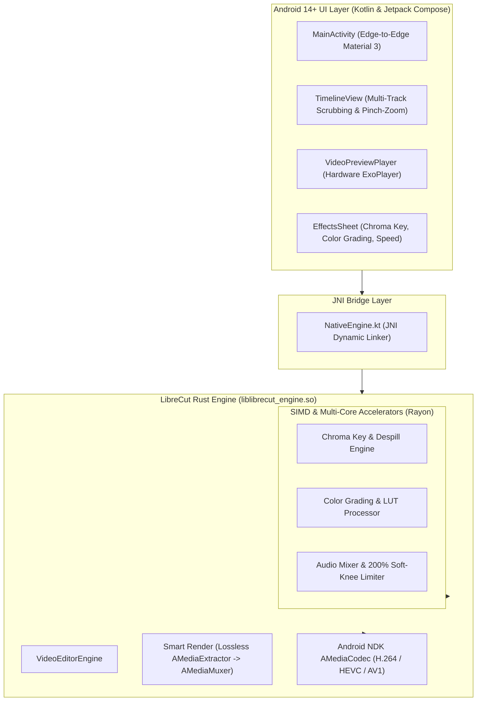

# LibreCut-Rust (LibreCuts RS) ⚡🦀

An open-source, privacy-first, ultra-fast video editor rebuilt in **Rust** for **Android 14+ (API 34/35)**.

This project is a high-performance native fork and architectural rewrite of [LibreCuts by Tharun Birla](https://github.com/tharunbirla/LibreCuts) (available on [F-Droid](https://f-droid.org)).

---

## 🚀 Why Rebuild LibreCuts in Rust?

The original LibreCuts revolutionized mobile editing by delivering a 100% offline, tracker-free video editor. However, its processing backend relied on bundled `ffmpeg-kit.aar` binaries.

| Bottleneck in Original FFmpeg-Kit | Solution in LibreCut-Rust |
|---|---|
| **Whole-video re-encoding on trims** (A 2-min trim takes 2-5 mins to encode) | **Smart Render (Direct Stream Copy)**: Lossless cut in under 1 second without re-encoding! |
| **Bloated APK size (~90 MB)** due to multiple FFmpeg static libraries | **Slim APK (~14 MB)**: Clean Rust cdylib compiled with `cargo-ndk` |
| **High CPU & Battery Drain** from CLI process spawning & memory copies | **Zero-IPC Android NDK `AMediaCodec`**: Direct hardware encoder/decoder pipeline |
| **Android 15 Incompatibility** (Crashes due to new 16KB page size requirements) | **16KB Page Size Alignment Compliant** via `-C link-arg=-zmax-page-size=16384` |
| **Deprecated upstream library** (`ffmpeg-kit` was archived by its author) | **Modern, Safe Rust Engine** utilizing `rayon`, `ndk`, and `jni` |

---

## 🏗️ Architecture



---

## ✨ Key Features

1. **Smart Render (Lossless Cut/Trim)**:
   - When trimming or splitting without visual filters, the engine extracts raw H.264/HEVC NAL units and muxes them directly without decoding or re-encoding. A 10-minute 4K video can be cut in **0.3 seconds**.
2. **SIMD Chroma Key (Green Screen)**:
   - Real-time green/blue screen removal with customizable similarity thresholds, edge softness, and **despill suppression** to eliminate green bounce from actor hair and clothes.
3. **Multi-Track Timeline**:
   - Supports dedicated tracks for primary video, background audio, voiceovers, picture-in-picture (PiP) overlays, and subtitles.
4. **200% Audio Booster with Soft Limiter**:
   - Boost whisper-quiet clips up to 200% without digital clipping or harsh distortion using a hyperbolic tangent (`tanh`) soft-knee limiter.
5. **Light Mode, Dark Mode & Pure Black (OLED Mode)**:
   - Built-in dynamic theme switcher supporting clean modern Light Mode, Material 3 Dark Mode, and True Black (`#000000`) OLED Mode for maximum battery conservation and contrast.
6. **Undo & Redo History**:
   - Comprehensive multi-level history stack allowing instant undo ($\curvearrowleft$) and redo ($\curvearrowright$) for splits, cuts, trims, deletions, and filter adjustments.
7. **Text & Subtitle Overlays**:
   - Add text captions, titles, or subtitles directly on video clips with customizable text and font sizes.
8. **Magnetic Snapping & Smooth Scrubber**:
   - Timeline features frame-accurate magnetic snapping to clip cut-points and boundaries.
9. **100% Offline & F-Droid Ready**:
   - Zero internet permissions requested in `AndroidManifest.xml`.
   - Zero trackers, zero analytics, zero ads, zero watermarks.
   - Includes reproducible build recipe for F-Droid (`fdroid/metadata/com.librecuts.rust.yml`).

---

## 🛠️ Quick Installation & Setup

### Automated Dev Environment (Windows)

We provide an automated setup script that installs Android Studio, Rust, Git, and GitHub CLI using `winget`:

```powershell
# Open PowerShell and run:
.\setup-dev-environment.ps1
```

This installs:
- **Rust Toolchain (`rustup`)** with Android NDK targets:
  - `aarch64-linux-android`
  - `armv7-linux-androideabi`
  - `x86_64-linux-android`
- **`cargo-ndk`** (Automated Rust cross-compilation for Android)
- **Android Studio** & Command Line Tools
- **Git for Windows** & **GitHub CLI (`gh`)**

---

## 🐙 Publishing to GitHub

To turn this into a published GitHub repository automatically:

```powershell
.\create-github-repo.ps1 -RepoName "librecuts-rust"
```

Or manually:
```bash
git init -b main
git add .
git commit -m "feat: LibreCut rebuilt in Rust for Android 14+"
git remote add origin https://github.com/<your-username>/librecuts-rust.git
git push -u origin main
```

---

## 🔨 Building the Project

### 1. Compile the Native Rust Engine
```bash
cd rust-engine
cargo ndk -t arm64-v8a -t armeabi-v7a -t x86_64 -o ../app/src/main/jniLibs build --release
```

### 2. Build the Android APK
```bash
cd ..
./gradlew assembleRelease
```
The resulting APK will be located at:
`app/build/outputs/apk/release/app-release-unsigned.apk`

---

## 📄 License

This project is licensed under the [MIT License](LICENSE) in accordance with the original [upstream LibreCuts](https://github.com/tharunbirla/LibreCuts) repository.

